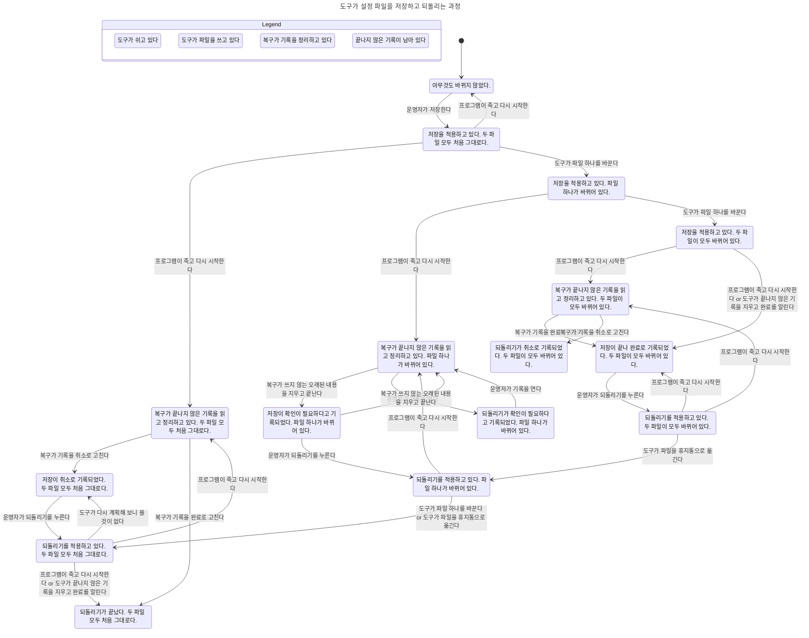
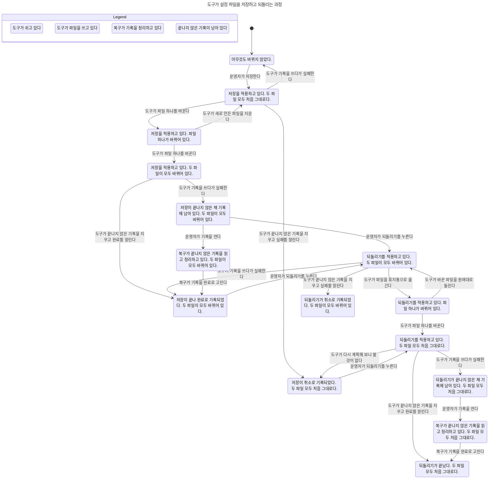
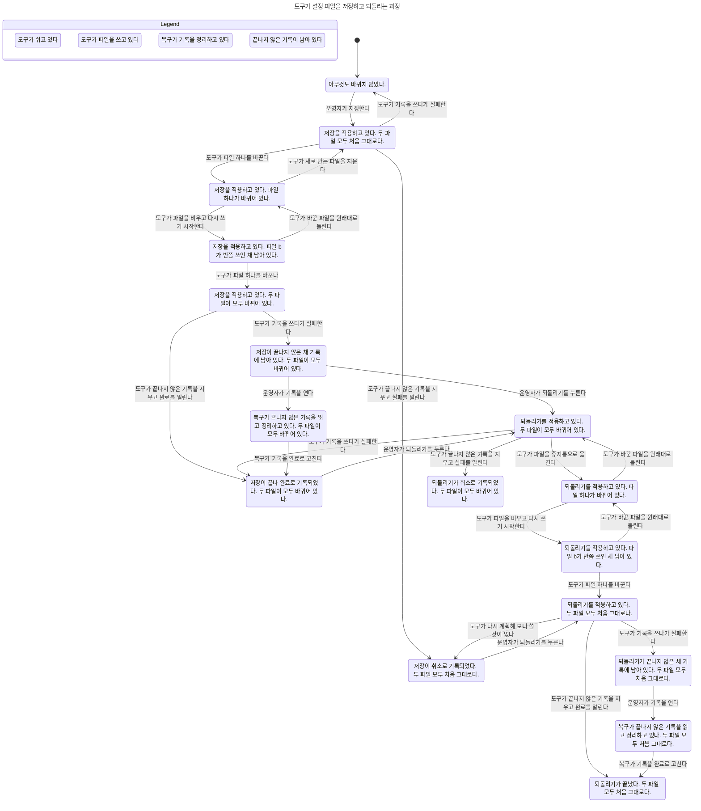

# 쓰기 과정 상태도

이 문서는 context-manager가 에이전트 설정 파일을 쓰는 과정을 상태도 세 개로 보여 준다. 상태도는 `TLA+` 모델 `formal/write-pipeline/WritePipeline.tla`에서 만들었다. TLC라는 검사 프로그램이 모델이 갈 수 있는 상태를 모두 찾았다. 상태도는 그 상태를 운영자가 보는 모습에 따라 묶어서 그린다.

## 먼저 알아 둘 말

**저장**은 운영자가 편집한 내용을 파일에 쓰는 일이다. 상태도의 저장은 파일 두 개를 바꾼다. 파일 `a`는 처음에 없다. 그래서 저장이 `a`를 새로 만든다. 파일 `b`는 처음에 `b0`이라는 내용을 담고 있다. 저장은 `b`를 새 내용으로 바꾼다.

**되돌리기**는 파일을 저장 전 내용으로 돌리는 일이다. 위의 저장을 되돌리면 도구는 `a`를 휴지통으로 옮긴다. 그리고 `b`에 `b0`을 다시 쓴다.

**기록**은 도구가 데이터 폴더의 `changes/` 아래에 쓰는 파일이다. 도구는 설정 파일을 바꾸기 전에 끝나지 않은 기록을 쓴다. 이 기록의 이름은 `changes/<id>.pending.json`이다. 도구는 설정 파일을 모두 바꾼 뒤에 `changes/<id>.json`을 쓴다. 그다음 끝나지 않은 기록을 지운다.

기록의 상태는 네 가지다.

- 완료(`Sealed`)는 변경이 모두 파일에 들어갔다는 뜻이다.
- 취소(`Aborted`)는 변경이 어느 파일에도 남지 않았다는 뜻이다.
- 끝나지 않음(`Pending`)은 적용이 아직 끝나지 않았다는 뜻이다.
- 확인 필요(`NeedsAttention`)는 운영자가 파일을 살펴봐야 한다는 뜻이다. 예를 들어 두 파일 가운데 하나만 바뀌어 있으면 이 상태가 된다.

**복구**는 프로그램이 시작할 때 실행된다. 운영자가 기록을 열 때도 실행된다. 복구는 끝나지 않은 기록마다 해당 파일을 읽는다. 모든 파일이 새 내용이면 복구는 기록을 완료로 고친다. 모든 파일이 이전 내용이면 기록을 취소로 고친다. 두 경우가 섞여 있으면 기록을 확인 필요로 고친다. 복구는 설정 파일을 쓰지 않는다.

## 모델이 검사하는 일곱 규칙

TLC는 모든 상태에서 아래 규칙을 검사한다. 괄호 안은 모델에서 쓰는 규칙 이름이다.

1. 복구와 기록 읽기는 설정 파일을 바꾸지 않는다 (`RecoveryWritesNoAgentFile`).
2. 도구는 어떤 변경의 내용을 그 변경을 적용하는 동안에만 쓴다 (`NoLateWrite`).
3. 도구가 덮어쓴 내용은 기록 폴더에 남는다 (`ReplacedTextKept`).
4. 완료로 기록된 변경은 모든 파일에 한 번은 들어갔다 (`SealedMeansDone`).
5. 취소로 기록된 변경은 어느 파일에도 남아 있지 않다 (`AbortedMeansNothing`).
6. 방해받지 않은 적용은 성공을 알리고 완료로 기록된다 (`UndisturbedApplySeals`).
7. 되돌리기는 모든 파일에 이전 내용을 다시 쓰고 기록을 닫는다 (`RevertRestoresAndCloses`).

여섯 번째 규칙에서 방해는 세 가지다. 프로그램이 죽는 일, 작업이 실패하는 일, 다른 쪽이 같은 파일을 쓰는 일이다.

## 상태도를 읽는 방법

상자 하나는 운영자가 볼 수 있는 상태 하나다. 상자의 문장은 기록의 상태를 적는다. 그리고 처음과 달라진 파일이 몇 개인지 적는다.

화살표 하나는 상태를 바꾸는 일 하나다. 화살표 이름의 `or`는 여러 일이 같은 상자로 이어진다는 뜻이다.

상자의 색은 도구가 하는 일을 나타낸다.

- 청록색 상자에서 도구는 쉬고 있다.
- 파란색 상자에서 도구는 파일을 쓰고 있다.
- 노란색 상자에서 복구는 기록을 정리하고 있다.
- 주황색 상자에는 끝나지 않은 기록이 남아 있다.

상자를 바꾸지 않는 일은 화살표로 그리지 않는다. 예를 들어 도구가 임시 파일을 쓰는 일은 상자를 바꾸지 않는다. 설정 파일의 내용이 그대로이기 때문이다.

## 상태도 1. 프로그램이 한 번 죽는 경우

이 상태도에서 프로그램은 하나다. 운영자는 저장을 한 번 하고, 그다음 되돌리기를 누른다. 프로그램은 어느 단계에서든 한 번 죽을 수 있다. 설정 파일은 `chart/crash.cfg`이다.

TLC는 상태 413개와 단계 669개를 찾았다. 상태도는 상태 16개와 화살표 27개를 그린다. 상자를 바꾸지 않는 단계 554개는 그리지 않았다. 모든 상태에서 일곱 규칙이 지켜진다.

이 상태도에서 볼 점은 세 가지다.

1. 저장 도중에 프로그램이 죽으면 다시 시작한 프로그램의 복구가 기록을 정리한다. 바뀐 파일이 없으면 기록은 취소가 된다. 두 파일이 모두 바뀌었으면 기록은 완료가 된다. 파일 하나만 바뀌었으면 기록은 확인 필요가 된다.
2. 복구는 반쯤 끝난 저장을 마저 쓰지 않는다. 바뀐 파일을 되돌리지도 않는다. 설정 파일은 운영자가 저장이나 되돌리기를 눌렀을 때만 바뀐다.
3. 완료 기록을 쓴 직후에 프로그램이 죽어도 저장은 완료로 보인다. 같은 변경에 완료 기록이 있으면 기록 목록은 끝나지 않은 기록을 보여 주지 않는다.

## 상태도 2. 파일 작업 하나가 실패하는 경우

이 상태도에서도 프로그램은 하나다. 운영자는 저장을 한 번 하고, 그다음 되돌리기를 누른다. 파일이나 기록을 쓰는 작업 하나가 실패할 수 있다. 예를 들어 디스크가 가득 차 있으면 쓰기가 실패한다. 설정 파일은 `chart/failure.cfg`이다.

TLC는 상태 235개와 단계 377개를 찾았다. 상태도는 상태 15개와 화살표 23개를 그린다. 그리지 않은 단계는 311개다. 모든 상태에서 일곱 규칙이 지켜진다.

이 상태도에서 볼 점은 세 가지다.

1. 파일 쓰기가 실패하면 도구는 이미 바꾼 파일에 이전 내용을 다시 쓴다. 새로 만든 파일은 지운다. 그다음 기록을 취소로 남기고 운영자에게 실패를 알린다.
2. 완료 기록을 쓰다가 실패하면 두 파일은 이미 바뀌어 있다. 도구는 운영자에게 실패를 알린다. 하지만 저장은 실제로 파일에 들어가 있다. 기록은 끝나지 않은 채 남는다. 운영자가 기록을 열면 복구가 기록을 완료로 고친다.
3. 끝나지 않은 기록을 쓰다가 실패하면 어느 파일도 바뀌지 않는다.

## 상태도 3. 하드 링크가 있는 파일을 쓰다가 실패하는 경우

하드 링크는 파일 하나에 이름을 둘 이상 붙이는 방법이다. 예를 들어 `AGENTS.md`와 `CLAUDE.md`가 같은 파일을 가리키게 할 수 있다. 보통 도구는 임시 파일을 쓴 뒤 그 이름을 대상 파일 이름으로 바꾼다. 하드 링크가 있는 파일을 이렇게 쓰면 한 이름만 새 내용을 가리킨다. 그래서 도구는 이런 파일을 제자리에서 쓴다. 먼저 파일을 비우고, 그다음 새 내용을 쓴다.

이 상태도는 상태도 2와 같다. 다만 파일 `b`에 이름이 하나 더 있다. 설정 파일은 `chart/in-place.cfg`이다.

TLC는 상태 279개와 단계 445개를 찾았다. 상태도는 상태 17개와 화살표 27개를 그린다. 그리지 않은 단계는 355개다. 모든 상태에서 일곱 규칙이 지켜진다.

이 상태도에서 볼 점은 세 가지다.

1. 도구가 `b`를 비운 뒤 쓰다가 실패하면 `b`는 반쯤 쓰인 채 남는다. 도구는 기록 폴더에 저장한 이전 내용을 `b`에 다시 쓴다. 그래서 `b`의 두 이름이 모두 이전 내용을 다시 가리킨다.
2. 그다음 도구는 새로 만든 파일 `a`를 지운다. 그리고 기록을 취소로 남긴다. 이때 두 파일의 내용은 처음과 같다.
3. 되돌리기가 `b`를 쓰다가 실패할 때도 같다. 도구는 되돌리기 전의 내용을 `b`에 다시 쓴다.

커밋 `480860e` 전의 도구는 반쯤 쓰인 `b`를 그대로 두었다. 그런데도 기록은 취소로 남았다. 모델은 이 문제를 `variants/in-place-torn.cfg`로 계속 검사한다. 이 설정은 고치기 전의 코드를 흉내 낸다. 그래서 이 설정의 검사는 실패해야 한다.

## 모델이 찾은 문제

이 문제는 프로그램이 죽어야 생긴다. 그래서 위의 상태도에는 없다. 설정 파일은 `findings/in-place-crash-revert.cfg`이다. 코드로 재현한 경로는 다음과 같다.

1. 운영자가 저장한다. 도구가 기록을 쓴다.
2. 도구가 파일 `a`를 새로 만든다.
3. 도구가 파일 `b`를 비우고 다시 쓰기 시작한다.
4. 프로그램이 죽는다. `b`는 반쯤 쓰인 채 남는다.
5. 운영자가 도구를 다시 열고 그 저장을 골라 되돌리기를 누른다.
6. 도구는 `b`가 이전 내용도 새 내용도 아니라는 것을 찾는다. 도구는 `b`를 충돌로 알리고 그대로 둔다.
7. 도구는 `a`를 지운다. 그리고 저장의 기록을 취소로 고친다.

마지막 기록에는 저장이 취소되었다고 적혀 있다. 그러나 `b`에는 저장이 쓰다 만 내용이 남아 있다. `b`의 이전 내용은 기록 폴더에 있다. 하지만 취소된 기록을 되돌리면 도구는 충돌을 알리고 멈춘다.

## 모델이 찾은 다른 문제

이 문제는 운영자가 도구 밖에서 파일을 고칠 때만 생긴다. 그래서 위의 상태도에는 없다. 설정 파일은 `findings/edit-in-window.cfg`이다.

1. 운영자가 저장한다. 도구가 기록을 쓴다.
2. 도구가 파일 `a`가 계획 때와 같은지 확인한다.
3. 도구가 임시 파일을 쓴다.
4. 운영자가 다른 편집기에서 파일 `a`에 새 내용을 쓴다.
5. 도구가 임시 파일로 파일 `a`를 바꾼다.

운영자가 4단계에서 쓴 내용은 기록 폴더에 없다. 도구는 그 내용을 덮어썼다. 그래서 되돌리기도 그 내용을 되살리지 못한다.

설계 문서 `docs/design.md`의 4절은 확인과 이름 바꾸기 사이의 시간을 받아들인다. 그 시간은 마이크로초 단위로 짧다. 설계 문서는 이전 내용이 이미 기록에 있으므로 잃는 것이 없다고 적는다. 하지만 모델은 운영자가 그 사이에 쓴 내용을 잃는다는 것을 보여 준다.

## 이 상태도가 그리지 않는 것

상태도는 프로그램 하나만 그린다. 프로그램 두 개가 같은 데이터 폴더를 함께 쓰는 경우는 그리지 않는다. 운영자가 도구 밖에서 파일을 고치는 경우도 그리지 않는다. 이런 경우는 `formal/write-pipeline/run.sh`가 검사하는 큰 모델에 들어 있다. 큰 모델의 상태는 160만 개가 넘는다. 그래서 그림으로 그릴 수 없다.

상태도마다 사고는 한 번만 일어난다. 프로그램이 죽는 일과 작업 실패가 함께 일어나는 경우는 큰 모델이 검사한다.

모델의 변경 번호는 두 개다. 그래서 상태도에는 저장 한 번과 되돌리기 한 번까지만 기록에 남는다.

디렉터리를 휴지통으로 옮기는 일은 모델에 없다. 심볼릭 링크와 파일 권한도 모델에 없다.

## 상태도를 다시 만드는 방법

`/statechart` 스킬을 쓴다. 스킬에는 `formal/write-pipeline/WritePipeline.tla`를 준다. 그리고 `chart/` 아래의 `.cfg` 파일 하나와 `chart/view.mjs`를 준다. 결과 폴더는 새 임시 폴더로 정한다. 스킬이 만든 `chart.mmd`의 내용을 이 문서의 해당 그림에 붙여 넣는다.
